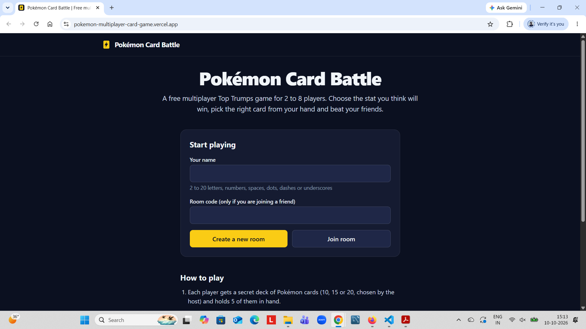

# Pokémon Card Battle

[](https://github.com/RohanLakade/pokemon-multiplayer-card-game/actions/workflows/ci.yml)

A free, real-time multiplayer Top Trumps card game for 2 to 8 players, each on their own device.
Choose a stat, secretly pick one card from your hand of five, and win the round when all cards are
revealed together.

**Play it: https://pokemon-multiplayer-card-game.vercel.app**

The free game server sleeps when idle, so the first request can take up to a minute.



> A fan project. Not affiliated with Nintendo, Game Freak or The Pokémon Company. Card data and
> artwork come from [PokéAPI](https://pokeapi.co).

## How it plays

- Each player holds a hand of 5 Pokémon cards and has a hidden draw pile of 10, 15 or 20 cards,
  chosen by the host. A played card is replaced from the pile, so the hand shrinks at the end.
- The round leader chooses one of 7 stats: HP, Attack, Defense, Sp. Attack, Sp. Defense, Speed or
  Rank. Everyone secretly picks a card, then all cards are revealed together.
- Mega, regional and Gigantamax forms are separate cards. Rank is the card's own id, so plain
  Pokémon beat forms in Rank rounds.
- The round winner leads next. A tie scores nothing. Most round wins takes the game, and equal
  scores share the win.
- An optional turn timer that any player can start, auto-play for players who step away, and
  rejoining a running game after closing the tab.

## What I built and learned

**Server-authoritative multiplayer.** The server holds every hand and decides every result.
Clients only receive their own hand, and a secret pick is never sent to others until everyone has
chosen. Tests check that hands and picks never leak.

**Real time with Socket.IO.** Rooms, a lobby, turns, a server-owned turn timer and
acknowledgement-based events. Players are identified by a private session token, not by socket id,
so refreshing, reconnecting and rejoining after closing the tab all work.

**Fair dealing.** Cards are placed in four tiers by Base Stat Total. Every deck follows the same
tier recipe, and decks are then balanced across all 7 stats, with extra weight on very strong
cards, by swapping cards inside a tier. The balance is measured on the real roster in tests.

**Security basics.** Zod schemas written once in a shared package and used by client and server,
CORS limited to the website, Helmet, request size limits, rate limits on REST routes and socket
events, limits on failed room joins, unguessable room codes, and error responses that never leak
stack traces.

**Modern frontend.** React 19, Redux Toolkit, React Router and Tailwind CSS v4 with design tokens in
CSS. Accessible by design: keyboard play, labelled controls, a native `<dialog>`, live regions for
turn changes, reduced-motion support, and a layout that works from 320px phones up.

**Testing.** Unit tests for game rules, dealing, auto-play and timers, real-socket integration
tests against a running server, component tests with React Testing Library, browser tests with two
players in Playwright, and a Postman collection for the REST API. CI runs everything on every push.

## Tech stack

| Area    | Tools                                                                          |
| ------- | ------------------------------------------------------------------------------ |
| Client  | React 19, Vite, Redux Toolkit, React Router, Tailwind CSS v4, socket.io-client |
| Server  | Node.js, Express 5, Socket.IO 4, Zod, Helmet, express-rate-limit               |
| Shared  | Zod schemas, game constants and stat rules (an npm workspace package)          |
| Data    | PokéAPI GraphQL, turned into `cards.json` by a build script                    |
| Testing | Vitest, React Testing Library, Playwright, Postman                             |
| Hosting | Vercel (website), Render free tier (game server), GitHub Actions (CI)          |

## Project structure

```
client/    React app: pages, components, hooks, Redux store, utils
server/    Express routes, controllers, services (game logic) and Socket.IO handlers
shared/    Zod schemas and rules used by both sides
scripts/   Card data build script (PokéAPI to cards.json)
postman/   Postman collection for the REST API
e2e/       Playwright browser tests
```

## Run it locally

You need Node.js 22 (or 20.19 and newer).

```
npm install
```

Create `server/.env` and `client/.env` (copy the `.env.example` files next to them), then start the
server and the website in two terminals:

```
npm run dev:server
npm run dev:client
```

Open http://localhost:5173. Use a second browser window (or a private window) as the second player.

## Scripts

| Command                | What it does                                                   |
| ---------------------- | -------------------------------------------------------------- |
| `npm test`             | Unit, socket and component tests (Vitest)                      |
| `npm run test:e2e`     | Browser tests with two players (Playwright, local servers)     |
| `npm run lint`         | ESLint                                                         |
| `npm run format`       | Prettier                                                       |
| `npm run build:client` | Production build of the website                                |
| `npm run build:cards`  | Rebuild `server/data/cards.json` from PokéAPI (needs internet) |
| `npm run audit`        | Security audit of production dependencies                      |

For the first browser test run, also run `npx playwright install chromium`.

## API

REST: `GET /api/health`, `GET /api/cards?limit=&offset=`, `GET /api/cards/:id`,
`POST /api/rooms` (returns a 6-character code) and `GET /api/rooms/:code`.

Socket.IO, client to server: `room:join`, `room:leave`, `room:set-deck-size`,
`room:set-turn-seconds`, `game:start`, `game:play-again`, `round:choose-stat`, `round:choose-card`,
`player:set-auto-play`, `timer:set`.

Socket.IO, server to client: `room:state`, `game:started`, `round:started`, `round:stat-chosen`,
`round:card-picked`, `round:result`, `game:over`, `player:disconnected`, `player:reconnected`,
`player:auto-play-changed`, `timer:changed`, `error`.

## Design decisions

- **The server decides everything.** It sends each player only what they may see, and a player's
  identity comes from the connection and a secret token, never from a field in a message.
- **No database.** Rooms and games live in memory. This keeps the project simple and free to host,
  and the cost is that a server restart ends running games.
- **Two hosts.** The website is static files on a CDN. The game server needs one long-running
  process that holds WebSocket connections and the rooms, which serverless hosting does not provide.
- **Game rules are code, not data.** Tiers, ranks and balance rules are applied when the server loads
  the card file, so a rule can change without downloading the data again.

## Known limits

- The free server sleeps after 15 minutes without traffic and rooms are lost when it restarts.
- Type badges and the three newest Pokémon are not included yet.
